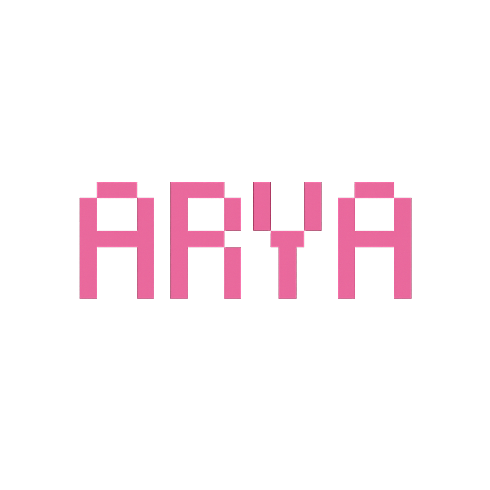

<!-- <h1 align="Center">hi  i'm   </h1>
 -->
<!-- <h1 align="center">
  hi
  
  i'm
   -->
</h1>
<h1 align="center">
  hi
  
  i'm
  
</h1>


Hello i'm Arya, studying Computer Engineering @ NYU.  

↓ hit in your terminal to connect with me

```bash
npx xoaryaa
```
↑ u can find this tool at [npx xoaryaa](https://github.com/xoaryaa/npx_card)


## skills
- **Architecture**: cache hierarchies, memory systems, systolic arrays, performance modeling, loop tiling and locality analysis

- **Programming Languages**: C++, Python

- **Tools and Platforms**: SCALE-Sim, PyTorch, scikit-learn, Linux, Git, Slurm


<!--- ## 📊 GitHub Stats

 <br>


<p></p>
-->
## connect with ME
[](https://linkedin.com/in/arya-tayshete)
[](https://instagram.com/aryatayshete)
[](mailto:aryatayshete.college@gmail.com)


<!--- ## 🌟 Let's Innovate Together!

Feel free to explore my repositories and projects. I'm always open to collaboration and new opportunities. Let's innovate and create something amazing together!

 -->
